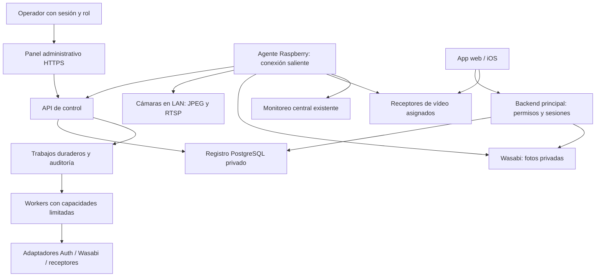

# Stable Eye: de instalaciones manuales a una plataforma operativa

Actualización v0.4: registro de organizaciones, roles y ámbitos de establo implementado en el panel aislado. Ver ORGANIZACIONES-Y-ESTABLOS-20261118.md para límites, API y pruebas. No activa permisos productivos ni incorpora instalaciones existentes.

Fecha: 18 de noviembre de 2026 · Alcance: miles de caballos y cientos de Raspberry.

Actualización 0.3: Auth/MFA, altas y paginación ya se probaron en un contrato Supabase aislado. Ver [AUTH-Y-ALTAS-20261118.md](AUTH-Y-ALTAS-20261118.md). Las brechas iniciales siguientes documentan el punto de partida y el objetivo completo.

## 1. Decisión y alcance real

La dirección es viable: convertir el panel en el punto de entrada para instalar una sede, incorporar sus cámaras y administrar accesos. No basta con llevar el demo a DigitalOcean. Falta implementar el aprovisionamiento, las integraciones y la operación segura de una flota. El inventario de unos miles de caballos es pequeño para PostgreSQL; el volumen de fotografías y vídeo es un problema distinto y considerablemente mayor.

Hay dos hitos separados:

1. **Desplegar un panel privado de pruebas:** autenticación real, base aislada, HTTPS, backups, proceso supervisado y verificación de seguridad. Puede hacerse antes de terminar todos los adaptadores.
2. **Reemplazar el procedimiento manual:** altas de personas/caballos, incorporación de equipos, red de cámaras, credenciales, IAM, fotos, metadatos, app principal, HLS, observabilidad, recuperación y soporte. Requiere ensayos reales antes de gestionar clientes.

El segundo hito no se acredita con un formulario, una migración SQL o un `/health` correcto. Cada integración debe demostrar su resultado con el consumidor real. El usuario mantiene autorización para desarrollar y probar de forma complementaria; no se ha autorizado migrar automáticamente cámaras actuales.

### Lo que seguirá necesitando una persona

Conectar alimentación/PoE y cableado, identificar físicamente una cámara, confirmar box/caballo, introducir secretos por canales seguros y resolver una avería de red o energía. El panel puede guiar y verificar esos pasos; no puede saber que el cable correcto se cambió solo porque alguien pulsó «Listo». Nuevos gastos, cambios de red que corten acceso y altas con mensajes a terceros requieren el alcance operativo correspondiente.

## 2. Evidencia revisada y límites

- Guía `outputs/guia-establos-20261106/GUIA_NUEVOS_ESTABLOS.md`, incluida la experiencia con Hospital, Bacatá, Casona y Rancho.
- Inventario de monitoreo y sus advertencias sobre servicios de usuario frente a servicios TCP antiguos.
- Copias GitHub obtenidas tras el push informado por el operador: webapp base `c4ba52b`, receptor base `65223ce`, más la primera entrega complementaria en ramas draft. Son referencias de código revisadas, no una certificación de la revisión desplegada hoy en cada Replit.
- Supabase `stable`, consultado por MCP **solo en lectura de metadatos**. Se verificaron columnas de `horses`, `user_profiles` e `images_wasabi`. No se importaron clientes al demo.
- Panel original: permisos simulados, inventario en borrador, auditoría, idempotencia y adaptador `off/shadow`. No tenía altas reales de Auth/caballos, enrollment, IAM ni instalación remota.
- Receptor revisado: `MAX_CAMERAS=7`, concurrencia de ingestión ligada a ese límite y presupuesto de buffers agregado de 64 MiB. Estado HLS en memoria. La app contiene listas por caballo/prefijo y origen HLS configurado en servidor.

Antes de ejecutar una integración se deben volver a comprobar commits, revisión publicada, esquema, servicios efectivos y recursos de destino. Una configuración histórica no es la fuente de verdad actual.

## 3. Matriz funcional: situación inicial y objetivo

| Área | Situación y brecha | Resultado necesario |
|---|---|---|
| Administradores | Demo local con identidad ficticia; verificador backend preparado | Login real, MFA para operaciones sensibles, roles explícitos y sesiones revocables |
| Personas | Selecciona perfiles existentes de prueba | Crear/invitar/reconciliar Auth y perfil, desactivar y cambiar acceso sin duplicados |
| Caballos | Usa catálogo existente; no crea caballos | Alta validada, propietario y box, edición de nombre sin alterar identidad, historial de sede/cámara |
| Sedes | Nombre y UUID en borrador | Red, zona horaria, contactos, ventanas de mantenimiento, organización y responsable |
| Raspberry | Nombre y sede en borrador | Enrollment seguro, identificación de hardware, capacidades, heartbeat, versiones y desired/reported state |
| Cámara | IP/MAC/caballo en borrador | Descubrimiento autenticado, aislamiento de fábrica, cambio de IP verificado, snapshots y códec real |
| Wasabi | Primera entrega no genera IAM | Planes precisos, aprovisionamiento con identidad separada, comprobación real de escritor y lector |
| Fotos | Agentes actuales ya funcionan | Instalar agente nuevo con cola persistente e ingestión idempotente, probar metadatos + objeto + app |
| HLS | Secret global y capacidad acotada | Registro de receptores, asignación por cámara, gestión de capacidad, credenciales y actualización sin perder otras entradas |
| App principal | Listas de caballos/prefijos en código revisado | Registro consultado en servidor y compatible con la ruta histórica; rutas por UUID |
| Permisos | Simulación y adaptador sin autoridad | Autoridad por recurso, sesiones privadas, expiración/revocación y prueba de acceso negativo |
| Monitoreo | Servicio separado existente | Enrollment del monitor por equipo y resultados verificables de captura, subida y live |
| Operación | Scripts y coordinación entre aplicaciones | Trabajos duraderos con reintentos limitados, evidencias, conciliación, rollback y mantenimiento |
| Escala | Demo y bootstrap con listados completos | Paginación integral, trabajos asíncronos, cuotas, métricas y prueba de carga del sistema completo |

No es necesario completar el último objetivo de escala para mostrar un staging privado. Sí es necesario antes de prometer una instalación masiva o convertirlo en autoridad de clientes.

## 4. Identidades y modelo de datos

### Identidades que nunca deben confundirse

- `auth_user_id`: cuenta que inicia sesión.
- Perfil de aplicación: identidad asociada a Auth; su rol no procede de campos editables por el cliente.
- `horse_id`: UUID permanente del caballo. Nombre y box son atributos que pueden cambiar.
- Propietario actual: asociación de negocio; no sustituye automáticamente el `user_id` de ingestión ni reescribe fotos históricas.
- `site_id`: sede estable. El nombre comercial puede cambiar.
- `device_id`: equipo lógico registrado; hardware/serial, claves y reemplazos tienen historial.
- Cámara física: MAC, serie y huella del equipo, contrastadas en la LAN. La MAC no es una credencial criptográfica ni basta fuera de un entorno controlado.
- `camera_id`: identificador técnico del flujo HLS. Conservar los nombres históricos aunque contengan `mock`; renombrarlos sin una migración rompe consumidores.
- `node_id`: reserva por sede para el contrato histórico `stable-eye/SITE_UUID/node_NODE_ID/`.
- `binding_id`: asociación con vigencia temporal entre cámara y caballo.
- `capture_id`: identidad idempotente de cada captura; no confundir con fecha de subida ni con un nombre de archivo reutilizable.

### Separación propuesta de registros

Reutilizar `auth.users`, `public.user_profiles`, `public.horses` e `images_wasabi` según su contrato real. Añadir entidades privadas de control: sedes, equipos, red de cámaras, bindings históricos, accesos, receptores y asignaciones, referencias a secretos, planes, trabajos, evidencias, auditoría y estado de migración.

La primera entrega usa `se_control_v1`, con RLS y rol de ejecución limitado. Las migraciones nuevas son aditivas; no reescriben la migración inicial. Los cambios a tablas existentes, cuando sean necesarios, se diseñarán por separado y con índices/migraciones adecuados al tamaño real.

**Hallazgo concreto:** `horses.stall_number` es obligatorio en Supabase. El demo simplificado no reproduce ese campo. Implementar un botón de alta basándose solo en `name` fallaría en producción. También deben revisarse triggers de creación de perfil, valores del enum de roles y FK reales antes de escribir Auth o caballos.

`images_wasabi` requiere campos de ingestión, propietario, horse/site/node, hash, tamaño, región/endpoint/bucket y rutas. No basta con subir un JPEG y guardar una URL. Conservar el contrato actual hasta diseñar una transición. Para IDs bigint, evitar convertir números fuera del rango seguro de JavaScript; usar cadenas en los límites de API.

### Red y restricciones

Reservar `camera_id` y MAC globalmente; reservar IP y nodo por ámbito de red/sede; conservar un binding vigente por caballo y cámara bajo el modelo actual. La implementación inicial reserva IP por sede: es deliberadamente conservadora. Si una sede tiene VLAN aisladas que repiten subred, introducir un `network_realm_id` antes de relajar esa restricción. No deducir que dos redes son independientes por tener nombres de sede distintos.

## 5. Convivencia con lo manual: condición de diseño

Cada recurso debe declarar quién lo administra: `legacy-observed`, `shadow`, `managed` o `retired`. El estado observado no autoriza a escribir sobre el equipo.

1. Importar inventario revisado sin credenciales y registrar procedencia/fecha.
2. Resolver discrepancias entre Supabase, unidades activas, Wasabi y receptor publicado. Si dos fuentes discrepan, marcar conflicto; no elegir automáticamente la más nueva por fecha de archivo.
3. Reservar identidades existentes para impedir que un alta nueva ocupe su cámara, caballo, IP, MAC o nodo.
4. Dejar los servicios y Secrets históricos fuera del reconciliador nuevo.
5. Para un alta nueva, comprobar también la red física y los recursos cloud. La ausencia de una entrada en el panel no demuestra que un recurso esté libre.
6. Adoptar una cámara actual solamente mediante otro procedimiento: previsualización de diferencias, estado deseado versionado, ventana, prueba y rollback.

La observación implementada en esta entrega es inmutable, de hasta 100 cámaras por lote. Repetir exactamente el inventario devuelve la observación anterior; una colisión parcial detiene el lote. Revisiones y conciliación incremental con fuentes externas todavía requieren desarrollo. Hasta completar el inventario, las reservas solo protegen lo registrado; **no garantizan ausencia de conflictos con recursos desconocidos**.

No reconstruir `HLS_RECEIVER_CONFIG` desde una plantilla antigua. Mientras haya receptores históricos, cualquier puente debe leer el valor actual privado, calcular un parche mínimo, exigir la versión/huella esperada y conservar campos desconocidos. Si otra operación cambió el Secret, invalidar el plan. El panel nunca debe enviar ese JSON completo al navegador por defecto.

## 6. Arquitectura objetivo

El panel administra; el almacenamiento y el vídeo transportan los bytes. No convertir el servidor del panel en proxy de todas las fotos y transmisiones. La webapp y el receptor siguen siendo componentes distintos aunque se administren desde una pantalla común.

### Componentes iniciales

API y worker pueden compartir una VM pequeña durante el piloto, en procesos separados y con límites. PostgreSQL de staging separado de producción; nada de PGlite como certificado de capacidad cloud. Cola en PostgreSQL para evitar añadir otro servicio al principio. Secretos en un mecanismo de almacenamiento/entrega seguro, no en columnas de texto plano dentro de planes/auditoría.

La VM del monitoreo existente debe conservar su función. El servidor nuevo no necesita convertirse en un nuevo punto de caída para las cámaras actuales. Una caída del panel debe impedir altas y cambios administrativos; los agentes continúan con su configuración válida y su cola local.

### Gestión de trabajos

No mantener una solicitud HTTP abierta mientras se descubre una cámara o se publica Replit. La API crea el trabajo y devuelve su ID. El worker reclama pasos mediante lease con vencimiento y token de generación; renueva la concesión en operaciones largas. Los resultados tardíos de un worker anterior se rechazan.

Los trabajos registran plan inmutable, actor, motivo, precondiciones, paso, intento, resultado saneado y evidencias. El plan debe invalidarse si cambian asociación, identidad, destino, versión de configuración o autorización del actor.

No existe una transacción única entre PostgreSQL, IAM, Raspberry y Replit. Se necesita una saga: confirmar qué ocurrió, reanudar de forma idempotente y compensar únicamente recursos creados por ese trabajo. Si se subió una foto pero fallaron los metadatos, reintentar su registro; no borrar la foto ni asignarla a otro caballo para despejar el error.

La cola de ensayo implementada ahora prueba reservas, pasos, leases de 30 segundos, resultados tardíos, cancelación y hasta tres intentos consecutivos por paso. Un fallo transitorio usa espera creciente. `AUTH_REJECTED` no se reintenta. No tiene un daemon ni ejecuta adaptadores reales; se avanza explícitamente desde el panel/API. El worker productivo necesitará renovación de leases, jitter, límites por proveedor/sede, outbox y reconciliación de efectos externos.

## 7. Altas de usuarios y caballos

### Usuarios

1. Buscar por correo normalizado sin revelar datos a operadores que no tengan alcance.
2. Si existe en Auth, verificar su perfil y reutilizar UUID. Si hay una coincidencia ambigua, detener.
3. Si no existe, preparar una solicitud idempotente. La invitación/envío de correo es una acción externa explícita y se audita.
4. Ejecutar Auth Admin desde backend con secreto de servidor. No insertar manualmente en `auth.users`.
5. Conciliar perfil/trigger con una máquina de estados: `requested`, `auth-created`, `profile-ready`, `invitation-sent`, `accepted`, `failed`. Si Auth creó la cuenta y luego falló el perfil, reparar esa cuenta; no crear otra.
6. Separar cuenta activa, acceso al caballo y administración del panel.
7. Desactivar/revocar con reglas de sesiones; no asumir que borrar un usuario invalida inmediatamente todos sus JWT o enlaces ya emitidos.

Auth Admin, claves secretas y roles deben permanecer en servidor. Para desarrollo con MCP usar proyecto/branch de pruebas y privilegios limitados. El MCP conectado a Codex facilita inspección y desarrollo; no es el login del panel ni una API administrativa que debamos exponer a usuarios.

### Caballos

Formulario con nombre, propietario verificado y `stall_number`; campos opcionales conforme al esquema. El backend valida UUID y rol. Generar una sola identidad lógica por solicitud, con índice de idempotencia para el alta. El nombre no es clave única: dos caballos pueden llamarse igual.

Cambiar el nombre no cambia prefijos, capture IDs ni HLS. Cambiar propietario o box es otra operación: cerrar asociaciones anteriores, crear nuevas con vigencia, preservar pendientes con el binding de captura y revisar permisos nuevos. No reasignar automáticamente todos los objetos históricos al propietario nuevo sin una decisión de negocio explícita.

No declarar `photo_backend=wasabi` utilizable hasta que lector, escritor, metadatos y app publicada estén listos. En altas nuevas se puede mantener una condición privada de «pendiente» sin inventar nuevos valores del enum/contrato público. En migraciones actuales, coordinar corte y conservar el backend previo hasta aceptar el nuevo.

## 8. Incorporación de Raspberry y recuperación

### Enrollment

El panel crea un código corto de vinculación, de un uso y vencimiento limitado, asociado a sede y solicitud. El equipo genera su clave local; canjea el código por HTTPS y demuestra posesión. Se registra serie/modelo/arquitectura/boot ID y versión del kit. No clonar discos que ya contengan identidad o claves de otro equipo.

Tailscale sirve para soporte y administración privada; no sustituye la identidad propia del agente. Usar claves de incorporación de un uso o un flujo OAuth con permisos acotados, nunca una clave reutilizable incorporada en una imagen pública. Definir tags/ACL que impidan a una Raspberry acceder a todas las demás.

### Agente

Conexiones salientes, configuración versionada y firmada/verificada, TLS estricto y protección contra replay. Ejecutar operaciones tipadas permitidas; no aceptar shell arbitrario desde un campo del panel. El proceso normal no debe tener privilegios root. Un helper privilegiado mínimo puede aplicar las operaciones aprobadas de red/systemd con lista de rutas/unidades exactas.

El agente mantiene `desired_version`, `applied_version` y `reported_version`, resultados y capacidad local. Guardar configuración nueva atómicamente, conservar anterior y activar solo tras validar. Una desconexión deja una operación «resultado desconocido», no la repite a ciegas.

### Recursos y reinicios

Detectar realmente Pi 4/5, RAM, disco, temperatura, undervoltage, aceleración disponible y versión FFmpeg. Una prueba de catálogo con 3.600 cámaras no demuestra que una Pi pueda transmitir 12. Medir fotos y todos los live simultáneos por modelo de equipo antes de fijar cupos.

Configurar servicios específicos, `Restart`, backoff y límites efectivos. Para unidades de usuario comprobar linger y el bus correcto. No reiniciar una unidad genérica `stable-eye-uploader` porque una cámara concreta falle. Preservar colas y credenciales. Logs con rotación y estados de cámara ausente, red caída y almacenamiento no disponible.

La cola local debe dimensionarse en bytes y antigüedad, no solo cantidad de ficheros. Con 12 cámaras a 100 kB por foto y diez segundos, una hora de corte acumularía unos 432 MB, antes de metadatos y margen. Es una estimación, no un cupo validado de hardware. Pausar uploads durante live puede empeorar la cola si el directo dura horas; cualquier prioridad debe tener límites y política de recuperación.

Tras un corte real, Raspberry, switch y cámaras arrancan en distinto orden. Esperar, descubrir, verificar identidad y reintentar con backoff sin bucles de reboot. Conservar configuración útil si el servidor de control está caído.

## 9. Cámara nueva: flujo físico sin conflicto

Las cámaras de la familia instalada pueden compartir `192.168.1.108` de fábrica. La IP no identifica el dispositivo.

1. Etiquetar cámara, cable, box y MAC/serie.
2. Preparar una VLAN/switch de alta o aislamiento físico de una sola cámara nueva. Mantener las cámaras productivas en su red. Si comparten una IP con la de fábrica y no hay aislamiento, coordinar el corte de la cámara concreta, como en Bacatá.
3. Detectar interfaces, rutas y subredes de Pi y Wi-Fi. No alterar gateway por defecto ni cortar Tailscale durante el alta.
4. Comparar MAC observada con la esperada antes de escribir. Si responde la otra cámara, detener y corregir cableado. Un HTTP 200 o ping no confirma identidad.
5. Reservar IP, comprobar DHCP/ARP y red real. Un ping sin respuesta no demuestra disponibilidad.
6. Guardar estado de red/encoders. Cambiar solo la interfaz y cámara objetivo mediante el adaptador admitido. No pasar contraseñas en argumentos visibles ni logs.
7. Seguir la cámara tras el cambio por identidad; verificar IP persistente. Esperar el reinicio si lo requiere el firmware. No repetir comandos durante su arranque como si fueran operaciones nuevas.
8. Medir JPEG real, dimensiones, bytes y encuadre. La familia tiene diferencias entre snapshot y flujo principal.
9. Leer el RTSP real con ffprobe: códec, perfil, nivel, resolución, fps, bitrate, B-frames y GOP/IDR. La respuesta ONVIF por sí sola no acredita H.264.
10. Conservar principal. Configurar un secundario compatible con HLS/Apple solo si está autorizado. Retransmitir H.264 con copia, manteniendo `-timeout`, límites y reconexión del kit.
11. Registrar evidencia y verificar persistencia después del reinicio dirigido de la cámara.

Aislamiento físico y evidencia de identidad son precondiciones. Una casilla «aislada» no sustituye la medición. La primera versión de herramientas ONVIF no soporta universalmente WSSE/Digest: se necesita matriz de modelos/firmware y adaptadores probados; no desactivar la seguridad de la cámara para hacerla compatible.

## 10. Wasabi: aprovisionamiento y acceso

Para cada sede/nodo usar el prefijo exacto del contrato histórico. No crear un bucket por caballo por defecto. El registro contiene bucket, región, endpoint aprobado y prefijo; las claves viven separadas.

### Identidades separadas

- **Aprovisionador central:** crea/adjunta recursos IAM permitidos. Nunca se instala en Raspberry ni navegador. Revisar las capacidades reales de la API IAM de Wasabi y las restricciones de la cuenta antes de automatizar.
- **Escritor por equipo o grupo autorizado:** limitado a sus prefijos. La instalación nueva debe evitar reutilizar una clave de otro establo. Para los equipos actuales, conservar credenciales y políticas hasta una rotación acordada.
- **Lector backend:** GetObject y ListBucket sobre lo que necesita la app; sin escritura/borrado.
- **Monitor:** lector separado y limitado.

La implementación de esta entrega genera documentos de política para revisión. No crea usuarios IAM, no adjunta políticas, no crea claves y no cambia buckets.

### Procedimiento automatizado futuro

Inventariar recursos, calcular diff, validar permisos mínimos y tags/procedencia, aplicar con precondición de versión y volver a leer adjuntos. Reintentar errores transitorios; ante 403 clasificar identidad/ARN/endpoint y detener cambios. No resolverlo haciendo público el bucket, entregando acceso a todo S3 o generando claves sucesivas.

Probar escritor con una captura de ensayo única y verificar su tamaño/hash. Probar lector con la **identidad que realmente usa el backend publicado**, no solo con la de la Raspberry. Este fue el problema de Encantador: la política estaba adjunta a otro usuario. El panel debe mostrar nombre técnico/fingerprint de identidad, políticas adjuntas y pruebas, sin mostrar claves.

No sobrescribir objetos con un nombre fijo. Versioning puede multiplicar almacenamiento al sobrescribir; Object Lock puede impedir eliminación o reemplazos según modo/retención. Registrar configuración, compatibilidad y fecha de liberación de retención; no activar/desactivar retención automáticamente. La política de duración mínima facturable se verifica con el contrato vigente y se diferencia de retención visible. Borrar pronto no garantiza ahorro.

Si la cuenta no permite automatizar IAM con la identidad disponible, el panel genera un paquete manual exacto y espera comprobación posterior. Ese modo guiado es preferible a simular éxito. La lectura de datos sigue siendo privada mediante URLs/cookies firmadas o el proxy autorizado.

## 11. Dos proyectos Replit y escalado del live

### App principal

Debe resolver caballo → backend de fotos/prefijo y caballo → cámara/receptor en servidor. Añadir registros dinámicos por UUID para instalaciones nuevas, conservando las listas históricas como ruta independiente. Nuevos registros no deben cambiar el origen global y desconectar los viejos.

El selector de permisos debe cubrir toda la ruta: metadatos, URL firmada/objeto, playlist, segmentos y sesión de vídeo. Una página protegida no protege un enlace público. No confiar en rol enviado por cliente, `localStorage` o `user_metadata`.

### Receptor

El receptor actual no es un servicio de flota para miles de cámaras. Necesitamos registro de receptores con capacidad medida, región, estado, versión y bytes de búfer. Asignación por cámara y credenciales con ámbito; varias cámaras de una sede pueden compartir receptor sin que exista una regla «un receptor por Raspberry».

Primera transición: nuevo receptor/camino de staging para altas nuevas. Después evaluar si conviene una implementación propia particionada, software especializado o distribución gestionada. La decisión depende de latencia, viewers, disponibilidad y coste medidos; no se ha contratado una plataforma en esta entrega.

Un registro dinámico evita reemplazar un JSON global para cada propietario. Cada cambio recibe versión y auditoría; los receptores consumen un snapshot verificado y acotado a su partición. Hashes de publicador permanecen en servidor, secretos de publicación en el equipo y mecanismo de entrega seguro. Rotación es una operación explícita, no un efecto del alta de otro caballo.

Para rutas migradas, si el servicio de permisos cae, no reabrir acceso con una lista antigua que restaure un permiso revocado. Definir cachés y vencimientos medidos. Para rutas históricas, una falla del servicio complementario no altera su decisión actual. Separar esas dos reglas por recurso es esencial.

### Compatibilidad y experiencia

Conservar H.264 real, sin recodificar vídeo en la Pi; validar IDR, SPS/PPS, segmentos y perfil. Safari/iPhone y Chrome deben reproducir movimiento. Metadatos sin fotogramas fue un error de códec, no prueba de conectividad satisfactoria.

Distinguir tiempo hasta primer movimiento de retraso de extremo a extremo y de interrupciones. Objetivo inicial: primer movimiento p95 ≤3 s bajo condiciones declaradas; continuidad y latencia se miden por separado. No prometer un segundo con HLS convencional sin medir. Si el formato/receptor no cumple, evaluar LL-HLS/WebRTC en una ruta nueva sin cambiar la histórica.

`/health=200` no acredita cámara cargada, hash correcto ni autorización. Para aceptar ingestión: segmentos nuevos por cámara con 204 durante al menos dos minutos, edad de último ACK, 401/403/429/5xx y reconexiones. Detener el publicador concreto ante rechazo de credenciales; no tocar otros servicios. Reiniciar el receptor histórico reconstruye ventanas y afecta sus cámaras: nunca ocultar ese impacto.

## 12. Escala: 3.600 caballos y cientos de equipos

Las siguientes son hipótesis de diseño, no medidas de la instalación actual: un caballo/cámara, fotos cada diez segundos, 100 kB decimales por foto y vídeo a 2 Mbps.

| Magnitud | A 3.600 caballos |
|---|---:|
| Capturas esperadas | 360 por segundo |
| Capturas/día | 31.104.000 |
| Capturas/mes de 30 días | 933.120.000 |
| Fotos/mes a 100 kB, una copia | 93,312 TB decimales |
| Fotos/90 días, una copia | 279,936 TB decimales |
| Vídeo continuo de todas las cámaras | 7,2 Gbps de entrada agregada |
| Subidas de segmentos de 2 s, todas continuas | 1.800 por segundo / 155.520.000 por día |

Duplicados, versiones, miniaturas, sobrecargas y copias se añaden a esas cifras. El tamaño JPEG y bitrate reales pueden variar mucho. Espectadores generan salida adicional. Estas cifras no son una cotización ni un plan de hardware aprobado.

### Cuellos de botella por orden de crecimiento

1. **Configuración manual y listas estáticas:** ya hacen lenta cada alta y permiso. El registro/planes resuelve coordinación, no transporte.
2. **Receptor HLS:** límite explícito, buffers, tasa de ingestión, estado en memoria y distribución a viewers. Aumentar `MAX_CAMERAS` no lo convierte en un clúster.
3. **Metadatos de fotos:** casi mil millones de filas nuevas por mes bajo estas hipótesis. Requiere retención, índices por caballo/fecha, escritura idempotente, colas y plan de partición/archivo probado. No decidir una migración enorme sin tamaño y consultas reales.
4. **Wasabi:** gran número de objetos, listado, retención efectiva, cuotas y duración mínima facturable. Consultar «última foto» debe usar metadatos/checkpoint; no enumerar todo el bucket periódicamente por caballo.
5. **Raspberry y WAN:** mezcla de snapshots, decodificación de JPEG, H.264 copy, SD, cola y subida. Starlink con buena señal no elimina cortes, variación de subida, congestión ni un switch caído.
6. **Monitoreo:** no hacer sondeos sin límite por objeto/equipo. Agregar latidos por dispositivo y eventos, limitar cardinalidad de métricas y guardar histórico/retención.
7. **Soporte:** cientos de sedes necesitan onboarding reproducible, diagnóstico, repuestos, responsables y turnos. Un panel no repara alimentación o cableado.

### Diseño para carga

API de control sin estado de sesión en memoria como única autoridad; pool Postgres acotado; trabajos asíncronos; paginación con cursor; índices; presupuesto de concurrencia por proveedor; backpressure; eventos/outbox; auditoría con retención/archivo. No disparar miles de llamadas de Auth o IAM simultáneamente.

Páginas del panel no deben descargar todos los caballos, grants, bindings y auditorías. Los endpoints nuevos ya limitan a 100 filas y buscan usuarios/caballos. En la versión 0.3, `bootstrap` devuelve hasta cien filas por colección y los selectores usan búsqueda acotada; se añadieron contadores y páginas de grants. La versión 0.4 añade lectura aislada por organización/establo y preparación delegada de nuevos establos con RLS. Las altas de personas/caballos, asignaciones y planes siguen siendo centrales. Falta ampliar y certificar esa delegación antes de incorporar administradores externos reales.

Pruebas de registro locales: 3.602 caballos paginados y 300 equipos/3.600 cámaras en PostgreSQL embebido. Sirven para detectar respuestas sin límite y duplicaciones; no certifican concurrencia entre conexiones reales, rendimiento cloud, fotos ni vídeo.

## 13. Seguridad, certificados y permisos

Separar operador de instalación, administrador de negocio, soporte, lector/auditor, worker aprovisionador y dispositivo. Un veterinario con fotos no es administrador del panel; un propietario de sede no administra IAM global. Definir tenant/sede de cada acción, no solo un rol genérico.

TLS público con dominio controlado y renovación automática; backend en loopback detrás de proxy; validar Host/origen del proxy permitido. No confiar en `X-Forwarded-*` de cualquier IP. TLS verificado también hacia Supabase/Wasabi y conexión Postgres. Reloj/NTP correcto; nunca `--insecure` como solución permanente.

Cookies HttpOnly/Secure/SameSite o BFF equivalente, CSRF, CSP, rate limit, sesiones y revocación. MFA/step-up para privilegios sensibles; no inferir autoridad de metadatos editables por el usuario. Identidad de dispositivo independiente y revocable.

Secretos entregados una vez por canal seguro y con permisos mínimos, archivos 600, cifrado/ACL y exclusión de backups públicos. No usar el plan JSON como almacén de RTSP, claves Wasabi, contraseñas Wi-Fi o HLS. No colocarlos en argumentos, URL de navegador, tickets, métricas ni registros de errores. Revisar redacción de logs y dependencias fijadas/lockfile.

RLS forzada sobre objetos privados, funciones privadas con permisos de ejecución explícitos y rutas de búsqueda fijas. Runtime sin escritura directa a Auth, sin alta propia de admins y sin borrado de auditoría. La cuenta de servicio del backend sigue siendo una frontera sensible: validar tenant/actor antes de cada acción privilegiada.

## 14. Activación y migración gradual

### Alta nueva

`draft → identities-ready → device-enrolled → network-verified → storage-ready → photos-verified → live-verified → recovery-verified → active`.

Se puede ofrecer fotos antes de live si el estado se muestra por capacidad. No presentar toda una instalación como activa si solo una parte funciona. Cada transición exige evidencias con hora, versión de configuración y fuente. El ensayo local termina en `simulated`, que no es ninguno de los estados de activación real.

### Instalaciones actuales

1. Inventario observado y comparación sin escritura.
2. Ejecución en shadow sin cambiar decisiones ni servicios.
3. Prueba con un caballo nuevo de ensayo y credenciales separadas.
4. Aceptación y piloto estable; reproducción Chrome/Safari/iPhone y denegación de otro usuario.
5. Migración explícita de una cámara, no una Raspberry completa por conveniencia.
6. Vigilar fotos, pendientes, streaming, usuarios y métricas antes de la siguiente.

El rollback devuelve la ruta de autoridad y configuración válidas para esa cámara; no borra fotos ya capturadas ni reescribe su `horse_id`. Restaurar un Secret antiguo puede retirar altas/permisos recientes: usar diff/versiones y restauración dirigida. No eliminar recursos que el trabajo solo encontró o que ya existían.

### Matriz de fallos que debe pasar

| Fallo inducido | Comportamiento requerido |
|---|---|
| Dos cámaras con IP de fábrica | Detectar ambigüedad, no escribir en ninguna |
| MAC equivocada tras cambio de cables | Detener y pedir corrección física |
| Corte de luz con cola | Reiniciar, recapturar, conservar pendientes y subir sin reasignación |
| Wasabi Put permitido / Get del lector denegado | No activar backend; informar identidad/política faltante |
| Objeto subido / metadata fallida | Reconciliar por capture_id, sin duplicar objeto/fila |
| Reinicio del worker durante IAM | Leer estado remoto antes de repetir; compensar solo lo creado por él |
| Worker viejo entrega resultado | Rechazar por lease/generación |
| HLS 401/403 | Detener solo el publicador afectado |
| HLS 429/5xx | Backoff y métricas; no acumular vídeo viejo indefinidamente |
| Control plane caído | Cámaras actuales continúan con su configuración útil |
| Permiso retirado en recurso migrado | No recuperar acceso mediante fallback histórico |
| Cámara sustituta en mismo box | Binding nuevo y pendientes históricos intactos |
| Disco lleno / hora equivocada | Estado explícito, no capturas falsas ni limpieza de pendientes silenciosa |

## 15. Plan de desarrollo con criterios de salida

Las fases representan dependencias y entregas, no fechas garantizadas.

| Fase | Entregable | Criterio para avanzar |
|---|---|---|
| 0 — Base | Demo, RLS, grants simulados, auditoría y `off/shadow` | Pruebas de aislamiento y compatibilidad anteriores aprobadas |
| 1 — En ejecución | Planes inmutables, inventario observado, reservas, artefactos, trabajos y paginación | Ensayos, colisiones, persistencia, cancelación y recuperación probados localmente |
| 2 — Staging seguro | Login real, MFA/roles, tenants, base aislada, proxy HTTPS, backups y CI | Usuarios con/sin privilegio y restauración verificados; exposición pública rechaza demo |
| 3 — Personas/caballos | Auth Admin idempotente, perfil conciliado, altas/edición/asignaciones | Doble clic y fallos parciales no duplican cuentas/caballos; correo solo en flujo autorizado |
| 4 — Equipo | Enrollment, identidad, estado deseado/reportado, agente y helper mínimo | Pi nueva sin claves clonadas; recuperación sin control plane; pruebas de replay/expiración |
| 5 — Cámara/fotos | Adaptadores por modelo, red, IAM writer/reader, agente de fotos | Instalación de ensayo con fotos en app publicada y ciclo de reinicio/corte |
| 6 — Live | Receptores registrados, capacidad, flujo dinámico y permisos completos | Movimiento Apple/Chrome, 204 sostenidos, negativas de acceso y dos directos simultáneos |
| 7 — Operación y escala | Métricas, cuotas, mantenimiento, soporte, carga y reconciliación | Carga objetivo acordada con pruebas cloud/end-to-end y presupuesto medido |
| 8 — Adopción | Una cámara actual por vez, aceptación, rollback | No regresiones del recurso ni de otros clientes; aprobación antes de ampliar |

### Entrega inicial 0.2

- Se añadió `002_installations.sql`, sin modificar `001_control.sql` ni aplicar migraciones cloud.
- Planes con huella de contenido, versión y reserva transaccional de cámara/MAC/IP/horse/node.
- Observaciones de inventario sin adopción y bloqueo de colisiones con lo registrado.
- Artefactos: asociación, prefijo, políticas escritor/lector y lista de pruebas pendientes. `executable=false`.
- Cola persistente de simulación, pasos, leases, límites de reintento, cancelación y rechazo de resultados tardíos.
- API paginada para catálogo, inventario, sedes, equipos, cámaras, planes y ensayos.
- Pestaña de planes: importar inventario revisado, guardar, descargar políticas y retomar ensayo.
- Pruebas de permisos SQL/HTTP, integridad, migración incremental, persistencia y volúmenes de registro.

**Todavía no:** alta real de usuarios/caballos, IAM automático, enrollment, comandos en Raspberry, cambio físico de IP, instalación de servicios, cambios en Secrets Replit, multi-tenant productivo, integración de autoridad o migración de clientes. Estas funciones no deben deducirse del resultado «simulado».

### Bloque iniciado y probado en 0.3

Se probaron Auth/MFA, catálogo de ensayo, paginación y altas de cuentas/caballos con idempotencia y conciliación. En 0.4 se añadió el primer bloque de organizaciones/ámbitos. Siguen pendientes la ampliación de altas delegadas, invitaciones, staging integral del legado, backups/CI y despliegue público. Ver el informe 0.3; ningún secreto administrativo debe pegarse en el chat.

## 16. Backlog de ingeniería y aceptación operativa

Prioridad P0 antes de administrar clientes:

- Entorno aislado y pruebas de Auth/roles con usuarios de prueba.
- Modelo de tenant/sede y matriz de privilegios, con pruebas negativas.
- Inventario completo y fuentes verificadas; política de propiedad por recurso.
- Gestión de secretos/enrollment y worker sin shell genérico.
- Auditoría con retención segura, idempotencia y conciliación de efectos parciales.
- Backups/restauración de registro, configuración y estado local; procedimiento de ruptura de acceso.
- CI/revisión de migraciones, dependencias y diferencias; no auto-merge/publicación desde el prototipo.

Prioridad P1 para instalaciones repetibles:

- Matriz de cámaras/firmware y preflight por modelo.
- Instalador versionado para Pi 4/5 y límites de recursos medidos.
- Adaptadores Wasabi writer/reader con lectura posterior y prueba efectiva.
- App principal compatible con registro dinámico y backend histórico.
- Registro/reparto de receptores y cambios con control de versiones.
- Pruebas de recuperación/revocación por cámara y herramientas de soporte.

Prioridad P2 antes de miles de caballos:

- Pruebas de carga/fallo entre conexiones Postgres reales, workers y WAN.
- Plan de volumen/retención/archivo de metadatos y objetos; coste por sede/caballo.
- Distribución de vídeo, cuotas, viewers y CDN/servicio elegido.
- Escalado de ingestión, backpressure, partición/archivo y observabilidad.
- Alta disponibilidad según SLO y restauración ensayada; límites de flota y despliegue por anillos.
- Operación de inventario, repuestos, responsables, alertas y mantenimiento.

Para aceptar una instalación real: dos capturas únicas visibles como mínimo, ciclo extendido de 24–48 h, fotos y directos simultáneos, lector no autorizado denegado, reboot y corte de red con recuperación. Un cambio de códec exige repetir prueba Apple. Registrar retardos y continuidad por separado, y errores/reconexiones aunque el proceso permanezca `active`.

## 17. Fuentes para implementación

- [MCP de Supabase](https://supabase.com/docs/guides/ai-tools/mcp): herramienta del agente; no sustituye la integración de runtime.
- [Usuarios de Supabase Auth](https://supabase.com/docs/guides/auth/users) y [Auth Admin createUser](https://supabase.com/docs/reference/javascript/auth-admin-createuser): administración desde servidor.
- [RLS de Supabase](https://supabase.com/docs/guides/database/postgres/row-level-security): autorización de filas.
- [PostgreSQL SELECT / SKIP LOCKED](https://www.postgresql.org/docs/current/sql-select.html): reclamación de trabajos; requiere pruebas concurrentes reales adicionales a PGlite.
- [Especificación HLS de Apple](https://developer.apple.com/streaming/hls-authoring-specification-for-apple-devices.html): compatibilidad de códec/contenedor y reproducción.
- [Tailscale auth keys](https://tailscale.com/docs/features/access-control/auth-keys): incorporación de equipos y claves de un uso.
- [Duración mínima de almacenamiento Wasabi](https://docs.wasabi.com/docs/how-does-wasabis-minimum-storage-duration-policy-work) y [Object Lock](https://docs.wasabi.com/docs/object-locking-enable): distinguir retención técnica, versiones y facturación.

La guía local existente sigue siendo la referencia de operación del sistema manual. Este documento añade el diseño de automatización y su secuencia de desarrollo; no autoriza a saltarse precondiciones ni reemplaza evidencia de campo.
